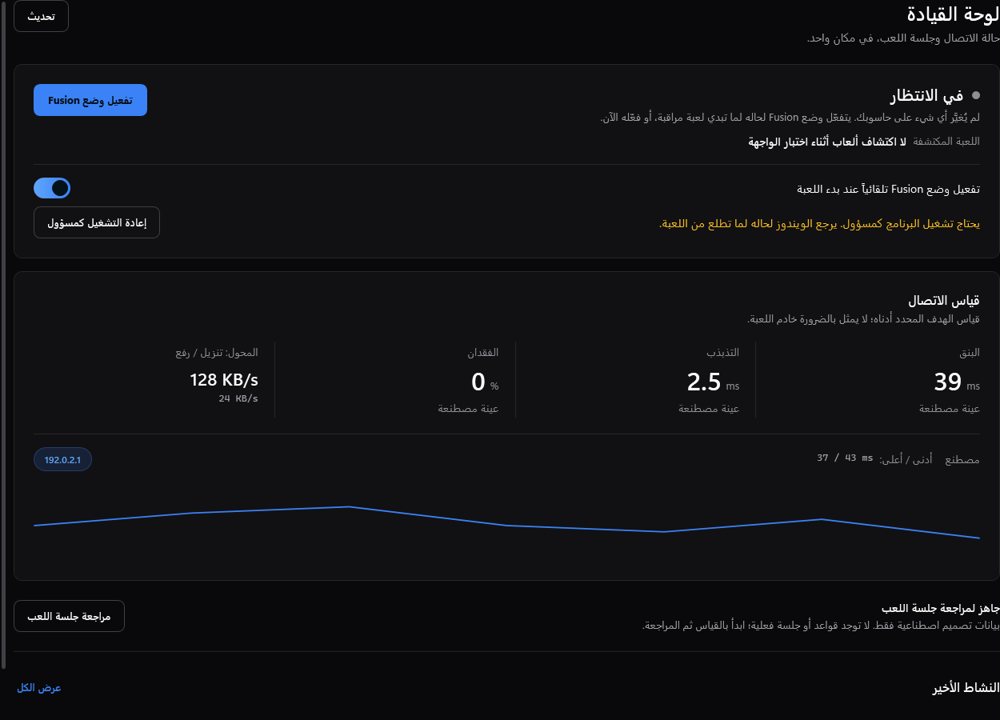

# FusionNet Pro

A Windows 10/11 gaming network tool (WPF, .NET 10, Arabic and English). It measures your connection, and while you play it keeps background apps and Windows services from competing with your game. Every change it makes is recorded in a journal and restored when you stop.

برنامج ويندوز للألعاب يقيس الاتصال، ووقت اللعب يوقف إنترنت البرامج والخدمات اللي بالخلفية حتى ما تزاحم اللعبة، وبعدين يرجّع كلشي لحاله.



## Download

Get the latest installer from **[Releases](../../releases/latest)**: `FusionNetPro-Setup-<version>.exe`.

- Installs per user. No admin rights are needed to install.
- The shortcuts start the app as administrator, because Fusion Mode changes firewall rules and services. Windows asks for approval each time you open it.
- **Updating:** download the newer setup from Releases and run it. It replaces the old version in place and keeps your settings.
- Releases are built and tested by GitHub Actions from the tagged source. The files are not code-signed yet (see the [code signing policy](CODE_SIGNING_POLICY.md)), so Windows SmartScreen may warn you the first time. Check the hash against `SHA256SUMS.txt` in the release.

## Features

- **Fusion Mode**: when a watched game starts (VALORANT, League of Legends, Counter-Strike 2, Fortnite, Apex Legends and more, plus your own), it blocks background apps with Windows Firewall rules, pauses update services, lowers background apps' priority, raises the game's priority and switches the power plan. It restores everything when the game exits, when you stop it, or when Windows signs out. Discord is only throttled, never blocked.
- **Game Boost**: a reviewed, manual session that temporarily blocks the internet for the apps you pick and restores them afterwards. Game launchers (Steam, Epic…) are only touched when every running game is a Riot game.
- **Live monitor**: ping, jitter, loss and adapter throughput to the targets you choose.
- **DNS**: inspect and benchmark DNS servers, and switch to one when you choose (restorable).
- **Security check**: a manual, read-only scan of running processes and connections.

Nothing changes on your PC until you engage a mode, and each change has a recorded way back.

## Build from source

Requirements: Windows 10/11 x64 and the [.NET 10 SDK](https://dotnet.microsoft.com/download).

```powershell
dotnet build FusionNet.slnx -c Release          # app and tests
dotnet run --project qa/TestRunner -c Release   # unit tests
powershell -File installer/build-installer.ps1  # packages into dist/
dotnet run qa/installer-safety.cs               # offline installer checks (needs the package step first)
```

Most scripts in `qa/` are offline checks you run with `dotnet run qa/<name>.cs`. Do **not** run `live-local-monitor-checks.cs`, `network-smoke.cs` or `test-installer*.ps1` on a machine you care about: they touch the real system.

## Releasing a new version

1. Bump the version everywhere `3.3.3` appears, mainly `Directory.Build.props`, `installer/build-installer.ps1`, `installer/FusionNet.Setup/FusionNet.Setup.csproj`, `InstallEngine.cs`, `SetupForm.cs` and `qa/release-checks.cs`. Find them all with `git grep 3.3.3`.
2. Commit, then push a matching tag:
   ```powershell
   git tag vX.Y.Z
   git push origin vX.Y.Z
   ```
3. The [Release workflow](.github/workflows/release.yml) builds, tests and packages it on GitHub's servers, then publishes the release with the installer, standalone exe, portable zip and `SHA256SUMS.txt`. It fails if the tag and the version differ.

To try a build without publishing, run the workflow manually from the Actions tab.

## Project layout

| Folder | What is in it |
| --- | --- |
| `src/FusionNet.Core` | Models, planning and policy logic (no Windows calls) |
| `src/FusionNet.Windows` | Firewall, services, processes, network and Win32 code |
| `src/FusionNet.App` | WPF interface, themes, localization |
| `installer/` | Per-user setup program and the packaging script |
| `tests/`, `qa/` | Unit tests and offline check scripts |

## License

[MIT](LICENSE). Third-party components are listed in [THIRD-PARTY-NOTICES.txt](src/FusionNet.App/Assets/THIRD-PARTY-NOTICES.txt). What the app sends over the network is listed in the privacy section of the [code signing policy](CODE_SIGNING_POLICY.md#privacy-policy).

Use it at your own risk: the app changes firewall rules, services and process priorities while a mode is active.
